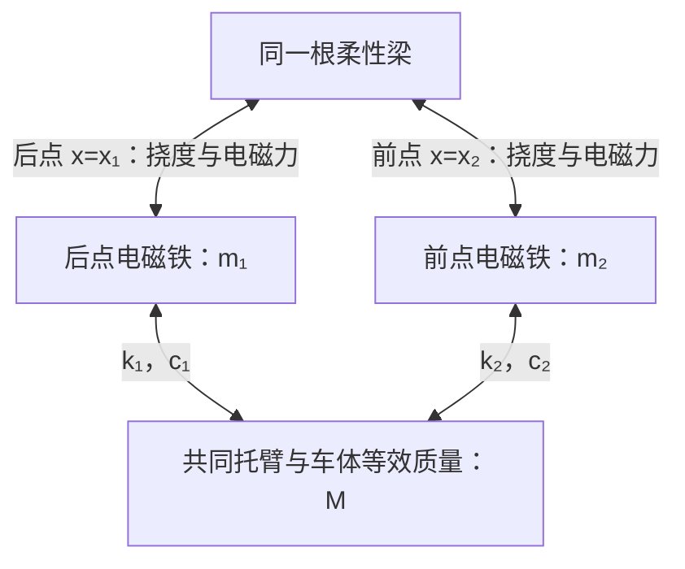

# 两点悬浮—柔性梁耦合动力学模型

## 1. 车轨耦合动力学模型的建立

考虑高速磁浮列车静止时的前后两点悬浮单元。下标j=1、2分别表示后点、前点，下标c表示两点共用的上部质量。按王珊等的最小悬浮单元模型[1]，将两块电磁铁的质量记为m₁、m₂，将共同托臂质量m₃与分摊到本单元的车体质量m₄合为M=m₃+m₄，质量单位均为kg。每块电磁铁分别通过弹簧和阻尼器与M相连：kⱼ为连接刚度（N/m），cⱼ为连接阻尼系数（N·s/m），分别描述弹性恢复作用和相对运动的耗能作用。车辆保留三个垂向自由度，即两块电磁铁与共同质量各自的上下位移。前后搭接关系见[1]图5及[5]图1。

轨道采用均匀简支Euler–Bernoulli梁，即两端可转动、以弯曲变形为主的梁，小挠度下保留第一阶或前两阶模态[2]。模态是一种固定的弯曲形状，模态坐标表示该形状的幅度；第一阶两半跨同向弯曲，第二阶两半跨反向弯曲、跨中为节点。

取垂向向下为正；x为从梁左端支座起算的水平位置（m），沿列车前进方向增大，L为梁跨度（m）。x₁、x₂分别是后、前悬浮点在梁上的固定水平坐标，满足0<x₁<x₂<L；默认分别为9.6 m和14.4 m，梁长24 m。统一用xⱼ表示第j点的水平位置，不随时间变化，与上下振动的位移区分。示意中的连接关系为：

设t为时间（s），Zⱼ、Z_c分别为电磁铁和共同质量的物理垂向坐标（m）。变量上方一阶点、二阶点分别表示对时间求导一次、两次，即速度（m/s）、加速度（m/s²）。Fⱼ为电磁吸力的大小（N），对电磁铁向上、对梁向下；Hⱼ为连接件作用于电磁铁的向下力（N），g为重力加速度（m/s²）。根据受力平衡可得

$$
\begin{aligned}
m_j\ddot Z_j&=m_jg+H_j-F_j,\qquad j=1,2,\\
M\ddot Z_c&=Mg-H_1-H_2.
\end{aligned}\tag{1}
$$

上标星号*表示受载静平衡，即承受重力时各力相互抵消、位置与电流保持不变的状态。令式(1)中的加速度为零，得到

$$
H_1^*+H_2^*=Mg,\qquad F_j^*=m_jg+H_j^*.
\tag{2}
$$

默认算例采用相同连接件、相同电磁铁质量及关于跨中对称的位置，故H₁*=H₂*=Mg/2，连接件的静变形大小为Hⱼ*/kⱼ。Fⱼ*为每点在平衡时所需的承载力。电磁力采用[1]式(4)和附件代码[3]的表达式，将磁路常量合并为电磁系数C_e（N·m²/A²）：

$$
F_j=C_e\frac{i_j^2}{\delta_j^2},\qquad
C_e=\frac{\mu_0N^2A}{4}.
\tag{3}
$$

其中iⱼ为线圈实际电流（A），δⱼ为电磁铁与梁之间的实际气隙（m），μ₀为真空磁导率（H/m），N为线圈匝数，A为有效磁极面积（m²）。给定受载平衡间隙δ₀（m），将式(2)的承载力代入式(3)，得到各点平衡电流i₀ⱼ（A）：

$$
i_{0j}=\delta_0\sqrt{\frac{F_j^*}{C_e}}.
\tag{4}
$$

采用附件代码的m₁=m₂=300 kg、M=330+2437.5 kg、N=270、A=0.115 m²、δ₀=0.01 m及g=9.81 m/s²，可得每点F*=16517.5875 N、i₀=25.04296159 A。

在上述受载平衡附近定义位移增量zⱼ=Zⱼ−Zⱼ*、z_c=Z_c−Z_c*，单位均为m；增量为零表示处于平衡位置，正值表示比平衡位置更低。线性连接件的力由静预载和运动增量组成：

$$
H_j=H_j^*+k_j(z_c-z_j)+c_j(\dot z_c-\dot z_j).
\tag{5}
$$

令ΔFⱼ=Fⱼ−Fⱼ*，表示相对平衡承载力的电磁力增量（N）。将式(2)、(5)代入式(1)，消去重力和平衡力，得到

$$
\begin{aligned}
m_1\ddot z_1&=-\Delta F_1-k_1(z_1-z_c)-c_1(\dot z_1-\dot z_c),\\
m_2\ddot z_2&=-\Delta F_2-k_2(z_2-z_c)-c_2(\dot z_2-\dot z_c),\\
M\ddot z_c&=k_1(z_1-z_c)+c_1(\dot z_1-\dot z_c)
+k_2(z_2-z_c)+c_2(\dot z_2-\dot z_c).
\end{aligned}\tag{6}
$$

这就是[1]式(3)在受载平衡附近的三自由度方程，与[3]中`a1`、`a2`、`a3`的机械连接一致。代码这三个变量是加速度，在本文中分别写为z̈₁、z̈₂、z̈_c；固定水平位置则统一写为x₁、x₂。

将三个位移合成向量u=[z₁,z₂,z_c]ᵀ，两路力增量合成ΔF=[ΔF₁,ΔF₂]ᵀ。粗体表示向量或矩阵，上标T表示转置，即将行列互换。用M_v、C_v、K_v分别表示车辆的质量、阻尼、刚度矩阵，B表示把两路电磁力分配到车辆方程的矩阵，可写为

$$
M_v\ddot{\boldsymbol u}+C_v\dot{\boldsymbol u}+K_v\boldsymbol u
=-B\Delta\boldsymbol F,\qquad
B=\begin{bmatrix}1&0\\0&1\\0&0\end{bmatrix},
\tag{7}
$$

各矩阵为

$$
\begin{aligned}
M_v&=\operatorname{diag}(m_1,m_2,M),\\
K_v&=\begin{bmatrix}k_1&0&-k_1\\0&k_2&-k_2\\-k_1&-k_2&k_1+k_2\end{bmatrix},\qquad
C_v=\begin{bmatrix}c_1&0&-c_1\\0&c_2&-c_2\\-c_1&-c_2&c_1+c_2\end{bmatrix}.
\end{aligned}\tag{8}
$$

这里diag表示将给定元素放在矩阵对角线上，其余元素为零；B的前两行使磁力分别作用于两块电磁铁，第三行零表示它不直接作用于共同质量。

接着引入梁的变形。**这部分最终用式(15)计算梁的振动，再用式(16)得到两个悬浮点处的梁挠度；式(17)将挠度接入悬浮间隙。**下面先给出它们的推导。

以梁自重平衡后的形状为几何基准，W(x,t)表示位置x、时刻t的总挠度，即梁向下弯曲的位移（m）。μ_b为梁线密度（kg/m）；EI为抗弯刚度（N·m²），其中E是材料弹性模量（Pa），I是截面二次矩（m⁴）。Pⱼ(t)为施加在两固定位置的已知外部垂向力（N），向下为正。按[2]式(15)—(19)，忽略阻尼时的连续梁方程为

$$
\mu_b W_{tt}+EI W_{xxxx}
=\sum_{j=1}^{2}[F_j(t)+P_j(t)]\delta_D(x-x_j),
\tag{9}
$$

其中W_tt、W_xxxx分别表示W对时间的二阶导数、对位置的四阶导数；δ_D是Dirac函数，用于把集中力定位到x=xⱼ，它与气隙δⱼ是不同符号。简支梁两端的位移和弯矩均为零；W_xx表示对位置的二阶导数，在小挠度下对应弯曲曲率，因此边界条件为

$$
W(0,t)=W(L,t)=0,\qquad W_{xx}(0,t)=W_{xx}(L,t)=0.
\tag{10}
$$

用正整数n表示模态序号。φₙ(x)为第n阶振型（无量纲），给出该形状沿梁的分布；ωₙ为固有角频率（rad/s）；Mₙ为该振型对应的等效惯性质量，即模态质量（kg）。满足式(10)的表达式为

$$
\phi_n(x)=\sin\frac{n\pi x}{L},\qquad
\omega_n=\left(\frac{n\pi}{L}\right)^2\sqrt{\frac{EI}{\mu_b}},\qquad
M_n=\int_0^L\mu_b\phi_n^2\,dx=\frac{\mu_bL}{2}.
\tag{11}
$$

以Qₙ(t)表示第n阶模态的总幅度（m），将梁变形写成各振型的叠加W(x,t)=Σφₙ(x)Qₙ(t)。把它代入式(9)，两边乘以另一振型φₘ并沿跨度积分；这里m也是模态序号，与质量mⱼ区分。利用简支边界和振型正交性（不同阶振型的交叉积分为零），有

$$
\int_0^L\mu_b\phi_m\phi_n\,dx=M_n\delta_{mn},\qquad
\int_0^L EI\phi_m''\phi_n''\,dx=M_n\omega_n^2\delta_{mn},
\tag{12}
$$

其中δ_mn为Kronecker符号：m=n时为1，否则为0。在第n阶加入模态阻尼比ζₙ（无量纲，用于描述振动耗散）后，得到

$$
M_n\ddot Q_n+2\zeta_n\omega_nM_n\dot Q_n+M_n\omega_n^2Q_n
=\sum_{j=1}^{2}\phi_n(x_j)[F_j+P_j].
\tag{13}
$$

静止且无外力时，Fⱼ=Fⱼ*，由式(13)求得受载静平衡模态坐标

$$
Q_n^*=\frac{\sum_{j=1}^{2}\phi_n(x_j)F_j^*}{M_n\omega_n^2}.
\tag{14}
$$

令qₙ=Qₙ−Qₙ*，表示第n阶模态相对受载平衡的幅度增量（m）。只保留前J阶，J=1或2；从式(13)减去其静平衡式，可得

$$
\ddot q_n+2\zeta_n\omega_n\dot q_n+\omega_n^2q_n
=\frac{1}{M_n}\sum_{j=1}^{2}\phi_n(x_j)[\Delta F_j+P_j],
\qquad n=1,\ldots,J.
\tag{15}
$$

由式(11)可知ω₂=4ω₁。f₁=ω₁/(2π)是一阶固有频率（Hz，即每秒振动次数）；给定L、μ_b及f₁后，EI=μ_b(2πf₁)²(L/π)⁴。该归一化也与原仓库的梁实现[4]一致。

定义两点形函数矩阵Φⱼₙ=φₙ(xⱼ)，即在第j个悬浮位置读取第n阶振型，Φ为2×J矩阵。令q=[q₁,…,q_J]ᵀ、P=[P₁,P₂]ᵀ，w=[w₁,w₂]ᵀ为两点相对受载平衡的梁挠度（m），Q_load为各模态受到的广义载荷（N）。两点挠度增量、速度和模态载荷可统一表示为

$$
\boldsymbol w=\Phi\boldsymbol q,\qquad
\dot{\boldsymbol w}=\Phi\dot{\boldsymbol q},\qquad
\boldsymbol Q_{\mathrm{load}}=\Phi^T(\Delta\boldsymbol F+\boldsymbol P).
\tag{16}
$$

两点的总挠度为Σφₙ(xⱼ)(Qₙ*+qₙ)。磁铁位移和梁挠度均从各自的受载平衡位置起算，因此实际间隙及其变化率为

$$
\delta_j=\delta_0+z_j-w_j,\qquad
\dot\delta_j=\dot z_j-\dot w_j.
\tag{17}
$$

将式(17)代回式(3)，梁变形就会改变电磁力；电磁力又通过式(15)作用于同一组梁模态，构成两点间的车轨耦合。式(16)的加载与读取满足

$$
(\Delta\boldsymbol F)^T\dot{\boldsymbol w}
=(\Phi^T\Delta\boldsymbol F)^T\dot{\boldsymbol q},
\tag{18}
$$

即在两点物理坐标和模态坐标中计算的输入功率相同。

**梁变形部分的最终结果与使用顺序：**

| 公式 | 作用 | 得到什么 |
| --- | --- | --- |
| 式(15) | 根据两点的电磁力增量与外力，随时间积分梁的模态运动方程 | 各模态的幅度qₙ(t)及速度 |
| 式(16) | 将各振型按幅度叠加，读取固定位置x₁、x₂处的变形 | 两点梁挠度w₁(t)、w₂(t)及速度 |
| 式(17) | 用磁铁位移减去梁挠度，再加平衡间隙 | 实际气隙δ₁(t)、δ₂(t)，用于计算电磁力 |

若只想看“两个悬浮点处的梁变形最终怎么算”，默认两阶时，式(16)展开为：

$$
w_j(t)=\sin\frac{\pi x_j}{L}\,q_1(t)
+\sin\frac{2\pi x_j}{L}\,q_2(t),\qquad j=1,2.
$$

这里q₁、q₂由式(15)积分求得，不能只根据当前力直接算出；一阶模型去掉第二项即可。式(9)—(14)给出推导与静平衡准备，其中式(14)的静平衡量在积分前计算一次；式(18)检查载荷投影前后的功率一致性。整个过程是“力激发梁振动 → 模态叠加得到挠度 → 挠度改变气隙 → 气隙改变电磁力”。

## 2. 闭环悬浮模型与自激振动

为使电磁力随悬浮控制动态变化，在上述机械和梁模型上引入[2]的电流回路。先看单个悬浮点，暂省下标j：i、δ、F分别表示该点电流、气隙和吸力；Lₑ(δ)为随气隙变化的线圈等效电感（H）。采用与式(3)一致的理想磁路，磁共能W′ₘ=Lₑ(δ)i²/2是用于由磁场关系求吸力的能量函数（J），这里撇号属于名称标记。对气隙求偏导（保持电流不变）得到吸力大小F=−∂W′ₘ/∂δ，从而有

$$
L_e(\delta)=\frac{2C_e}{\delta},\qquad
F=-\frac{\partial}{\partial\delta}\left(\frac12L_ei^2\right)
=C_e\frac{i^2}{\delta^2}.
\tag{19}
$$

设Rₑ为一个等效悬浮点的总电阻（Ω），uⱼ为线圈端电压（V）；恢复点下标j，线圈电压方程为

$$
u_j=R_ei_j+\frac{d[L_e(\delta_j)i_j]}{dt}
=R_ei_j+L_e\dot i_j-\frac{L_ei_j}{\delta_j}\dot\delta_j.
\tag{20}
$$

该式包含间隙变化引起的反电动势，对应[2]式(6)、(7)。式(19)、(20)将该文成对线圈的电感、电阻统一为与本模型电磁力系数一致的等效总量。

按[2]式(13)，采用间隙比例与磁铁绝对速度反馈。控制器给出的目标电流记为i_ref,j（A），它与线圈实际电流iⱼ区分；k_p为间隙比例增益（A/m），k_d为绝对速度反馈增益（A·s/m）。电流指令为

$$
i_{\mathrm{ref},j}=i_{0j}+k_p(\delta_j-\delta_0)+k_d\dot z_j,
\tag{21}
$$

其中δⱼ−δ₀是间隙误差，żⱼ是磁铁相对固定参考系的绝对速度。电流内环采用电阻压降前馈，并以增益k_I（V/A）反馈目标电流与实际电流之差，令

$$
u_j=R_ei_j+k_I(i_{\mathrm{ref},j}-i_j),
\tag{22}
$$

k_I中的下标I表示电流环，不是PID的积分项；本模型没有间隙误差积分反馈。将式(22)代入式(20)，消去电阻项，再用式(17)替换间隙变化率，得到

$$
\dot i_j=\frac{k_I}{L_e(\delta_j)}(i_{\mathrm{ref},j}-i_j)
+\frac{i_j}{\delta_j}(\dot z_j-\dot w_j).
\tag{23}
$$

本项目将[1,3]的机械连接与[2]的控制、电路组合，并由式(15)—(17)接入柔性梁；电磁力采用附件的1/4系数，电感按同一系数由式(19)构造。记vⱼ=żⱼ、v_c=ż_c为磁铁与共同质量的速度，pₙ=q̇ₙ为模态幅度的变化速度，单位均为m/s。将位移、速度与实际电流合成完整状态向量x（公式中用粗体，与标量梁坐标x区分）：

$$
\boldsymbol x=[z_1,z_2,z_c,v_1,v_2,v_c,
q_1,\ldots,q_J,p_1,\ldots,p_J,i_1,i_2]^T.
\tag{24}
$$

机械自由度为3+J：车辆三个位移，加上J个梁模态幅度。每个机械自由度保存位移和速度，再加入两路实际电流，因此一阶梁时共有10个状态，两阶梁时共有12个状态。由于位移采用受载平衡增量、电流采用实际值，平衡状态为

$$
\boldsymbol x^*=[0,\ldots,0,i_{01},i_{02}]^T.
\tag{25}
$$

将式(3)、(6)、(15)、(17)、(21)、(23)合并，最终得到可直接积分的一阶闭环方程：

$$
\boxed{\begin{aligned}
\dot z_j&=v_j,\\
\dot v_j&=\frac{-\Delta F_j-k_j(z_j-z_c)-c_j(v_j-v_c)}{m_j},\\
\dot z_c&=v_c,\\
\dot v_c&=\frac{1}{M}\sum_{j=1}^{2}[k_j(z_j-z_c)+c_j(v_j-v_c)],\\
\dot q_n&=p_n,\\
\dot p_n&=-2\zeta_n\omega_np_n-\omega_n^2q_n
+\frac{1}{M_n}\sum_{j=1}^{2}\phi_n(x_j)(\Delta F_j+P_j),\\
\dot i_j&=\frac{k_I}{L_e(\delta_j)}
[i_{0j}+k_p(\delta_j-\delta_0)+k_dv_j-i_j]
+\frac{i_j}{\delta_j}\left(v_j-\sum_{n=1}^{J}\phi_n(x_j)p_n\right).
\end{aligned}}
\quad\substack{j=1,2\\n=1,\ldots,J}
\tag{26}
$$

式(26)中，δⱼ=δ₀+zⱼ−Σφₙ(xⱼ)qₙ，ΔFⱼ=Cₑiⱼ²/δⱼ²−Fⱼ*，Lₑ=2Cₑ/δⱼ。因此给定当前状态和两路外力Pⱼ，所有状态导数均已确定，将式(26)右端记为状态演化函数f(x,P)。

在未触及物理边界的平衡邻域内，记eⱼ=zⱼ−wⱼ=δⱼ−δ₀为间隙误差（m），ĩⱼ=iⱼ−i₀ⱼ为电流增量（A）。F_i,j、F_δ,j分别表示电磁力对电流、对间隙的灵敏度大小（N/A、N/m）；增大电流使吸力增大，增大间隙使吸力减小。将式(3)在(δ₀,i₀ⱼ)展开，可分析闭环振荡稳定性：

$$
\Delta F_j\simeq F_{i,j}\tilde i_j-F_{\delta,j}e_j,\qquad
F_{i,j}=\frac{2F_j^*}{i_{0j}},\qquad
F_{\delta,j}=\frac{2F_j^*}{\delta_0}.
\tag{27}
$$

同样将式(23)线性化，并记L₀=Lₑ(δ₀)为平衡间隙处的电感（H），得到

$$
\dot{\tilde i}_j=\frac{k_I}{L_0}(k_pe_j+k_dv_j-\tilde i_j)
+\frac{i_{0j}}{\delta_0}(v_j-\dot w_j).
\tag{28}
$$

将式(27)、(28)与线性机械、梁方程组合，即得到平衡点Jacobian矩阵A=∂f/∂x，它描述各状态的小变化如何影响状态导数；此处矩阵A与式(3)的磁极面积A按上下文区分。其特征值λ=α±iω中，α为局部振幅增长率（s⁻¹），正值表示增长、负值表示衰减；ω为振荡角频率（rad/s），ω/(2π)为频率（Hz），这里i为虚数单位，与电流iⱼ区分。令梁挠度为零可得到刚轨闭环；同一组参数下刚轨稳定而耦合后出现α>0的复特征值，表明车梁反馈引入了振荡失稳。

其能量机制可直接由梁方程推得。记E_b为相对受载平衡的梁振动能量（J），𝒫_eb为电磁力增量向梁输入的功率（W）；能量对时间的导数也是功率。将式(15)乘以Mₙpₙ并对模态求和，得到

$$
\begin{aligned}
E_b&=\frac12\sum_{n=1}^{J}M_n(p_n^2+\omega_n^2q_n^2),\\
\dot E_b&=\underbrace{\sum_{j=1}^{2}\Delta F_j\dot w_j}_{\mathcal P_{eb}}
+\sum_{j=1}^{2}P_j\dot w_j
-\sum_{n=1}^{J}2\zeta_n\omega_nM_np_n^2.
\end{aligned}\tag{29}
$$

式(29)分别给出了电磁力输入功率、外力输入功率和梁阻尼耗散。无外力时，当电磁力输入功率的周期平均值大于平均阻尼耗散功率，梁的振动能量增长，并在主导振荡下体现为振幅增长。电流回路通过有限带宽和反电动势改变电磁力与梁速度的相位，控制电源由此持续向振动供能，这与[2]的做功分析一致。

将梁能量与车辆动能、连接弹性势能相加，定义总机械振动能量E_mech=E_b+u̇ᵀM_vu̇/2+uᵀK_vu/2（J），再结合式(7)、(18)，可进一步得到

$$
\dot E_{\mathrm{mech}}=-\sum_{j=1}^{2}\Delta F_j(v_j-\dot w_j)
-\sum_{j=1}^{2}c_j(v_j-v_c)^2
-\sum_{n=1}^{J}2\zeta_n\omega_nM_np_n^2
+\sum_{j=1}^{2}P_j\dot w_j.
\tag{30}
$$

自激工况取P₁=P₂=0，从受载平衡附近施加小扰动，用振幅增长率、主频与电磁输入功率描述振荡过程。

## 3. 数据生成

每条轨迹按配置确定质量、连接件、梁、控制器与两点位置，采用等分承载H₁*=H₂*=Mg/2，由式(2)、(4)、(14)计算静载、平衡电流和梁静挠度，再按式(25)构造平衡状态并叠加初始微扰。当x₂=L−x₁时，第一阶振型在两点同号、第二阶异号。z₊=(z₁+z₂)/2为两磁铁的共同位移分量，z₋=(z₁−z₂)/2为差动位移分量（相对位移的一半），单位均为m，分别描述同向和反向运动。默认独立采样两磁铁位移，使两类分量均受到激发；也可由`common_m`、`differential_m`单独指定微扰。

数值积分采用Radau，并在tₖ=kΔt、k=0,…,T−1的公共时间轴上读取状态：Δt为采样间隔（s），k为采样序号，T为每条轨迹的采样点数，因此末时刻为(T−1)Δt。每个采样时刻，由式(16)计算两点梁挠度；用Y表示预测所需的位移输出、U表示已知外部输入：

$$
\boldsymbol Y(t)=[z_c,z_1,z_2,w_1,w_2],\qquad
\boldsymbol U(t)=[P_1,P_2].
\tag{31}
$$

Y的五列依次为共同质量、后点电磁铁、前点电磁铁、后点梁、前点梁的位移增量，单位均为m；U为后点、前点的梁上外力，单位为N，自激主工况中为零。用O表示辅助观测，由式(6)、(17)、(29)同时读取：

$$
\boldsymbol O(t)=[\delta_1,\delta_2,\ddot z_1,\ddot z_2,\ddot z_c,i_1,i_2,\mathcal P_{eb}].
\tag{32}
$$

两点间隙和电流为物理实际值，加速度由动力学方程直接计算，功率单位为W。到达设定时长或间隙、电流边界时结束轨迹，保存实际有效时段。本节用N表示轨迹条数，与电磁公式中的线圈匝数N按上下文区分。N条轨迹最终组成$Y\in\mathbb R^{N\times T\times5}$、$U\in\mathbb R^{N\times T\times2}$；这里ℝ表示实数数组，三个维度依次为轨迹、时刻、输出或输入列。X表示按式(24)排列的完整状态数据，X和辅助观测O同时保存；各条实际参数、初值、种子、平衡量及有效长度随数据写入配置指定的NPZ文件。程序字段中的`z_m1`、`z_m2`对应本文z₁、z₂。

## 4. 来源基线与正式实现验收

### 原附件16状态模型（P1）

原附件模型包含6个机械状态和10个观测器/滤波状态，采用25 A基准电流、零初态、0—100 A电流限幅和0.1 mm计算间隙地板。在2—4 s施加两点相同的3 mm、7 Hz采样轨道位移，按原代码线性插值，积分至5 s。

MATLAB R2024a运行原`ode15s`模型（相对容差10⁻⁶、绝对容差10⁻⁹、最大步长0.5 ms），得到119022个自适应输出点。另以逐式翻译的SciPy Radau独立积分核对，对应容差和步长为10⁻⁹、10⁻¹²、0.5 ms。MATLAB状态经PCHIP重采样到统一0.5 ms网格后重新计算观测，两者最大绝对差为：间隙9.0061×10⁻⁹ m、加速度0.0132914 m/s²、电流0.00285444 A，其中包含积分与重采样误差。

原零初态下每点加速度为0.18874580964577034 m/s²：25 A、10 mm时吸力16460.96375710627 N，小于承载力16517.5875 N，因此它不是静平衡。正式模型改用式(4)的25.042961588229478 A。原MATLAB电流曾短暂触及0 A，统一网格会漏过这段限幅；[legacy_baseline.npz](../data/example/legacy_baseline.npz)同时保留原始自适应观测和统一网格的完整16状态、间隙、加速度、电流、轨道输入及JSON来源记录，其版本为`legacy_supplied_16state_P1_only`。

王珊表1的m₃为450 kg，原附件采用330 kg。按论文相应线性模型，330 kg得到角频率36.42008128、155.89172077、193.46649361 rad/s，与论文式(26)的36.42、155.89、193.47相符；450 kg得到35.92747838、155.89172077、192.00067384 rad/s。本项目采用附件330 kg，并记录该来源差异。

### 10/12状态组合模型（P2—P5）

实现按式(26)建立平衡、动力学与观测。采用种子20261016，`z_m1,z_m2,z_c,q1,…,qJ`分别施加10 μm标准差正态微扰，初速度和电流增量为零。Radau积分10 s，采样1 ms，相对容差10⁻⁸、尺度化绝对容差10⁻¹¹，最大步长0.5 ms；柔性梁工况在2—9.5 s拟合线性特征坐标的振幅和相位，同时保存q₁峰值拟合结果。

| 电流增益，V/A | 模态数 | 刚轨最大实部，s⁻¹ | 耦合主导实部，s⁻¹ | 非线性拟合增长率，s⁻¹ | 非线性频率，Hz |
| --- | --- | --- | --- | --- | --- |
| 65 | 1 | −7.32041002 | +0.22582985 | +0.22587509 | 9.98153423 |
| 65 | 2 | −7.32041002 | +0.22582985 | +0.22587509 | 9.98153423 |
| 80 | 1 | −9.13093452 | −1.61463685 | −1.61463682 | 10.10520709 |
| 80 | 2 | −9.13093452 | −1.61463685 | −1.61463684 | 10.10520709 |

刚轨非线性对照均衰减，65/80工况的拟合增长率分别为−7.32040926、−9.13093073 s⁻¹，与刚轨特征值一致。为避免后期响应接近数值精度影响拟合，采用0.1—1 s区间；末1 s峰值与初态的尺度化状态范数比约2.64×10⁻¹²、2.35×10⁻¹²，梁状态始终为零。

时域频率与特征值频率差小于1%，增长率差小于5%。两阶步长由0.5 ms减至0.25 ms后，65/80的最大间隙差分别约1.0640×10⁻¹³ m、2.9362×10⁻¹⁴ m，增长率绝对变化约1.9×10⁻¹⁰ s⁻¹、1.4×10⁻⁸ s⁻¹，频率变化均小于2.5×10⁻⁹ Hz。

两阶对称位置的共同微扰中，第二模态峰值约1.7×10⁻¹⁹ m；反对称微扰中约1.0832×10⁻⁶ m，验证了差动通道的激发。一阶与两阶的共同主导特征值在该对称设置下重合；模态截断收敛仍需更高阶对照。

两阶65工况在拟合区间的平均电磁输入功率约0.03554089 W，大于梁阻尼耗散0.02690038 W；80工况约6.6321×10⁻⁸ W，小于耗散5.0927×10⁻⁷ W。两者外力功均为零。逐点/模态功率、梁能量导数及总机械能导数的相对残差均通过10⁻¹⁰阈值，另保存时间积分能量收支差值。

`validate_model`对照单模态解析自由响应、同阶静挠度解析式和完整简支梁静解，记录截断误差及带单位的平衡导数，归一化平衡残差小于10⁻⁹。默认两点静挠度各为5.048289 mm，完整梁静解为5.074203 mm，截断误差为−25.914 μm。实际配置、初态、谱、拟合、功率与步长差值保存在[科学验收记录](../data/example/scientific_validation.json)，每次启用的验收报告也随生成数据保存。模型公式与实现、三份正式文档已分别完成独立审阅。

**参考文献与代码来源**

[1] 王珊、徐俊起、倪菲、高定刚、陈琛、林国斌．轨道不平顺激扰下高速磁浮列车悬浮控制参数边界及优化研究．《振动工程学报》，2026，39(5)：1336—1344．[DOI](https://doi.org/10.16385/j.cnki.issn.1004-4523.202508057)，[本地论文](references/wang2026.pdf)。机械连接依据为图5、式(3)，电磁力依据为式(4)。

[2] Jinhui Li, Jie Li, Danfeng Zhou, Lianchun Wang. The Modeling and Analysis for the Self-Excited Vibration of the Maglev Vehicle-Bridge Interaction System. Mathematical Problems in Engineering, 2015, Article 709583. [DOI](https://doi.org/10.1155/2015/709583)，[本地论文](references/li2015.pdf)。电路与控制依据为式(6)—(14)，梁模型依据为式(15)—(19)，能量分析见第2.3节。

[3] 用户附件《两点模型.txt》，[原始MATLAB源码](references/two_point_original_matlab.txt)。机械与电磁参数见文件开头，`symmetryDynamics`包含原16状态控制实现与三自由度机械方程；保留原文用于P1基线溯源。

[4] [Sailero/MaglevCoupledDynamics的梁实现](https://github.com/Sailero/MaglevCoupledDynamics/blob/11098d16a7b0ad4cb6fca258543389214a0e2fd6/maglev_sim/plant/physics/beam.py)，固定提交`11098d16a7b0ad4cb6fca258543389214a0e2fd6`；参考`mode_mass`、`natural_frequency`和`BeamModes`。

[5] 倪菲、罗一凡、徐俊起、范琳．物理信息机器学习驱动的高速磁浮列车悬浮系统动力学响应预测．《振动工程学报》，2026，39(5)：1365—1377．[DOI](https://doi.org/10.16385/j.cnki.issn.1004-4523.202508095)。第1367页图1用于核对前后搭接结构。
