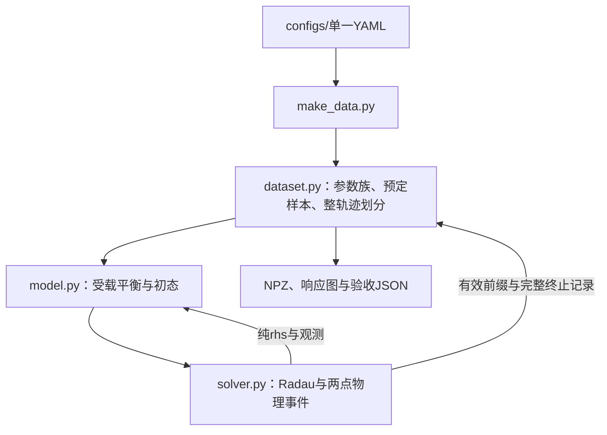

# 项目架构

## 文件结构与职责

```text
项目根目录/
  configs/default.yaml          # 全部仿真、数据和验收设置
  data/                         # NPZ、响应图、验收数值
    example/                    # v2样例、科学验收和原附件基线
    legacy_v1/                  # 已标明版本的旧单点样例
  sim/                          # Python 3命名空间包
    model.py                    # 配置、平衡、方程、观测、模型验收
    solver.py                   # Radau、外力、事件、科学验收
    dataset.py                  # 样本、划分、NPZ读写、按列名作图
  docs/
    dynamic_model.md            # 模型推导与验收记录
    project.md                  # 架构与数据合同
    references/                # 原论文PDF与原MATLAB源码存档
  make_data.py                  # 唯一入口，接收配置文件名
  readme.md                     # 使用说明
  requirements.txt             # 运行依赖
```

四个Python文件组成完整运行实现；`sim`采用命名空间包，验证函数放在对应模块中，由配置开关触发。

## 数据流



配置先通过字段、有限值与物理范围检查。模型预计算形函数矩阵、模态质量与频率，建立受载平衡；梁动力学加载相对平衡的`Delta F`与外力`P`。各组数组中的点序为后点1、前点2。`rhs(t,x,force)`返回状态导数，不改变输入状态和随机数状态。

求解器采用尺度化绝对容差`scaled_atol * scales`。状态尺度为`[0.01 m×3,0.5 m/s×3,0.01 m×J,0.5 m/s×J,i0×2]`，时间尺度为1 s。输出时间轴为`dt*arange(T)`。两点实际间隙和电流触及边界即终止；计算用间隙地板只保护除法。事件根保存独立时间和完整状态，积分异常保存最后接受状态。有限脉冲按起止点分段积分，脉冲内部限制步长。

## v2数据合同

每份NPZ固定模态数、列序、公共时间轴与张量精度。保存内容均为数值或Unicode数组，使用`allow_pickle=False`读取。

| 字段 | 形状/类型 | 含义 |
| --- | --- | --- |
| `format_version`、`model_version` | 标量 | `2`、`stationary_two_point_v2` |
| `t`、`dt` | `(T,)`、标量 | 公共时间轴及间隔，s |
| `Y`、`U` | `(N,T,5)`、`(N,T,2)` | `[z_c,z_m1,z_m2,w1,w2]`与`[P1,P2]` |
| `X` | `(N,T,8+2J)` | `[z_m1,z_m2,z_c,v_m1,v_m2,v_c,q1,…,qJ,p1,…,pJ,i1,i2]` |
| `O` | `(N,T,8)` | `[gap1,gap2,a_m1,a_m2,a_c,i1,i2,beam_port_power]` |
| `*_names`、`*_units` | 对应列数 | 列名与每列SI单位 |
| `valid`、`valid_length` | `(N,T)`布尔、`(N,)`整数 | 有效前缀与长度 |
| `sample_index`、`seeds` | `(N,)` | 原始预定索引及uint64初值种子 |
| `split`、`family_id` | `(N,)` | 整轨迹划分及参数族编号 |
| `parameter_names`、`parameter_values` | `(P,)`、`(N,P)` | 实际物理参数展开名称与数值行 |
| `config_json`、`actual_config_json` | 标量、`(N,)`字符串 | 请求的完整配置与逐轨迹实际配置 |
| `initial_state`、`equilibrium_state` | `(N,8+2J)` | 实际初态与静平衡状态 |
| `equilibrium_force`、`equilibrium_current`、`equilibrium_w` | 各`(N,2)` | 平衡承载力N、电流A、两点静挠度m |
| `equilibrium_q` | `(N,J)` | 平衡模态坐标，m |
| `success`、`termination_reason` | `(N,)` | 是否到达请求末时刻及终止原因 |
| `termination_time`、`termination_state` | `(N,)`、`(N,8+2J)` | 事件/末次接受时间及完整状态，时间单位s |
| `solver_message` | `(N,)`字符串 | 求解器说明或数值异常 |
| `config_sha256`、`source_sha256` | 字符串标量 | 规范配置及四个实现文件的SHA256 |
| `git_commit`、`git_dirty` | 字符串、布尔标量 | 生成时版本与跟踪文件修改状态 |
| `validation_json` | 字符串标量 | 本次启用验收的数值报告 |

Y为受载平衡增量位移；X最后两列、O的间隙与电流为实际物理值。O的加速度由方程计算，端口功率为`Delta F @ (Phi @ p)`，单位W。U保存梁上已知外力，无外力时有效段为零。

每条预定轨迹运行一次；提前终止时，X/Y/U/O保留有效前缀，尾段填NaN并置`valid=False`。初态越界的有效长度为0，初态和终止状态仍保存。参数无效时，保留`invalid_parameters`记录、实际参数及种子；未定义的初态、平衡和终止量为NaN。

读取时检查格式、列名、公共网格、有效段与NaN尾段、参数行、掩码、终止记录与参数族划分。相同配置与种子可重现参数、初态、划分和数值轨迹，Git字段记录生成时的仓库状态。

## 采样与划分

`dataset.seed`通过`SeedSequence`分出参数族与轨迹种子序列，各参数族和轨迹使用独立`Generator`。`parameter_ranges`在指定区间均匀采样，每个参数族共享一组实际参数，轨迹按索引循环分配给参数族；族数取配置值与轨迹数的较小值，无参数范围时全体属于族0。

`split_by: trajectory`按完整轨迹划分；`family`按完整参数族划分。比例采用最大余数分配，同余数依train、val、test顺序，再由`split_seed`打乱。小批量可能没有某个划分。训练时先按`split`选轨迹，再在`valid=True`的连续段切窗。

## 验证与来源

`validate_model`检查受载平衡、力方向、梁自由响应、截断静挠度与完整梁静解、形函数功率以及能量恒等式。`validate_solver`检查物理边界、终止状态、有效前缀、异常保留和窄脉冲。`validate_dataset`使用小批量真实积分检查无pickle读回、重现、失败保留与参数族划分。`validate_scientific`执行模型文档所述65/80对照和步长收敛。

原附件16状态模型的MATLAB/SciPy基线见模型文档，原始文本和PDF保存在`docs/references`。长期实现采用式(26)的10/12状态组合方案，旧单点样例保存在`data/legacy_v1`。
